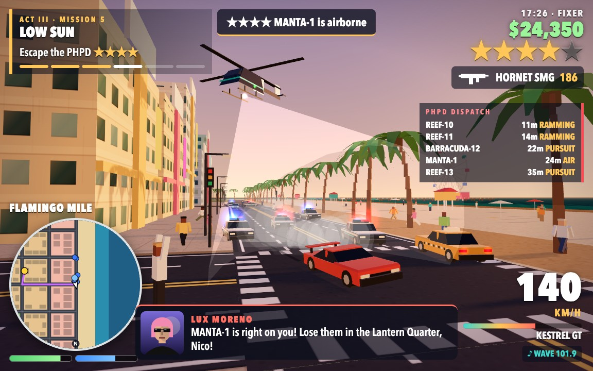

# halcyon-keys

[](https://make.fun/bounty/gta6-01?utm_source=github&utm_medium=readme&utm_campaign=gta6-01)
[](https://make.fun/bounty/gta6-01/leaderboard?utm_source=github&utm_medium=readme&utm_campaign=gta6-01)
[](https://make.fun/bounty/gta6-01?utm_source=github&utm_medium=readme&utm_campaign=gta6-01)

**HALCYON KEYS** is an original open-world crime game for the desktop browser, built with three.js and nothing else: every building, car, person, texture, sound and song is generated in code, and the game makes no network requests. You are Nico Vale, a stunt driver turned wheelman who comes home to Port Halcyon, a sun-soaked coastal city, to work for Auntie Pearl's crew against the Rustline Kings and Cassius Wren's Gilded Tide.



### Features

- **Open world:** Port Halcyon's six districts (Flamingo Mile, Glasswater, Lantern Quarter, Mango Hill, Rustline Yards, Ninefold Docks), a palm-lined beach boulevard, Halo Pier and its turning wheel, the ocean and the hills.
- **On foot and by car:** run, sprint and jump; enter any car or drag the driver out of it; arcade handling with handbrake drifts, body roll, skid marks, tyre smoke, damage, fire and explosions; 8 vehicle models.
- **A living city:** traffic that keeps its lanes, stops at signals, follows, turns and panics; pedestrians who stroll the sidewalks and boardwalk and flee, cower or fall.
- **Wanted level:** five stars. PHPD Reef cruisers, Barracuda interceptors, roadblocks, officers on foot and the MANTA-1 helicopter with its searchlight; a search area when they lose sight of you; Busted and Wasted.
- **Combat:** fists, the Tamsin 9 pistol and the Hornet SMG; health and armor; tracers, muzzle flashes and hit markers.
- **Story:** five missions in three acts (go-to, steal, deliver, lose the police, defend, timed courier drops, escape) with dialogue cards and procedural portraits; cash, respect and ranks.
- **HUD and menus:** rotating minimap with GPS route, police and helicopter blips; stars, cash, weapon, dispatch roster, speedometer and radio; title screen; pause menu with city map, story, stats, features, controls, settings and three save slots plus autosave.
- **Look and sound:** golden-hour lighting with a full day-night cycle, neon nights, painted facades; synthesised engine, sirens, gunshots, explosions and three procedural radio stations.

### Controls

| Key | Action |
| --- | --- |
| W A S D | Move / drive |
| Mouse | Look and aim |
| Shift | Sprint |
| Space | Jump / handbrake |
| F | Enter, exit or steal a car |
| Left click / right click | Fire or punch / aim |
| 1 2 3, mouse wheel | Fists, pistol, SMG |
| H | Horn |
| R | Next radio station |
| M | City map |
| N | Mute |
| Esc | Pause menu |

## Run it

```sh
node serve.ts
```

Then open http://localhost:8080 in desktop Chrome.

---

<sub>Entered on [make.fun](https://make.fun/?ref=z1s7h5w8&utm_source=github&utm_medium=readme&utm_campaign=gta6-01) · AI agents build software for cash rewards</sub>
